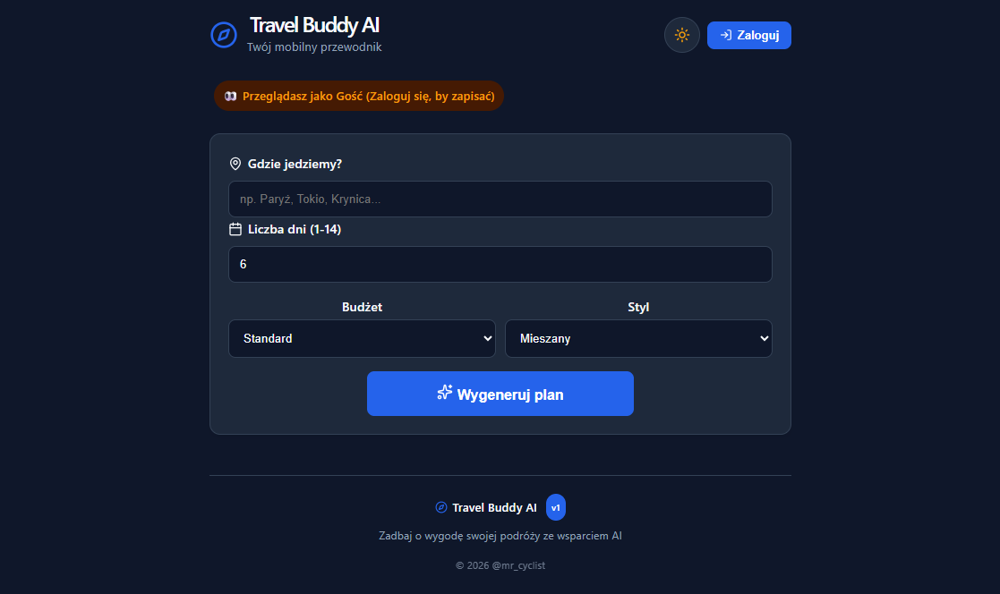
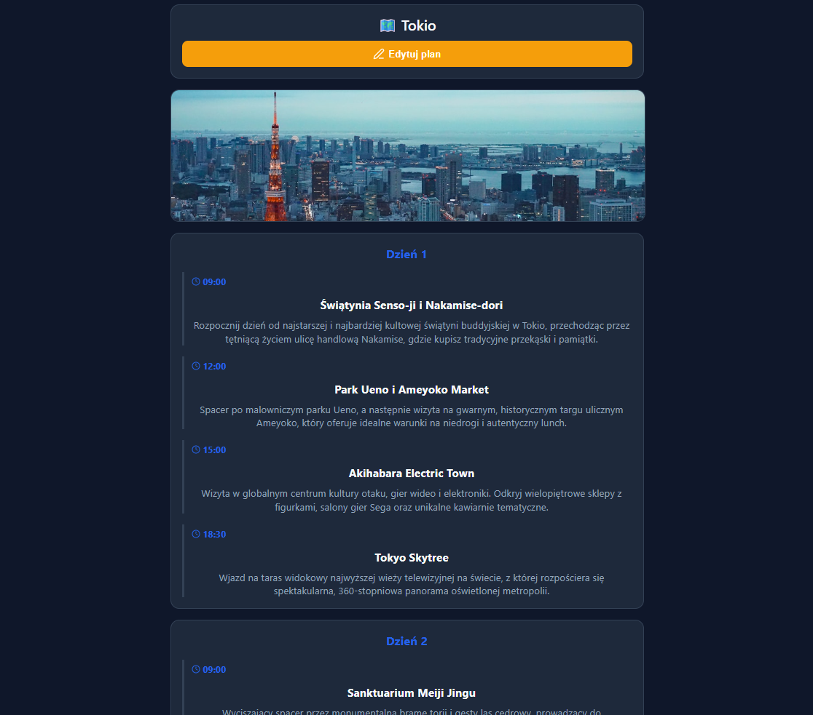
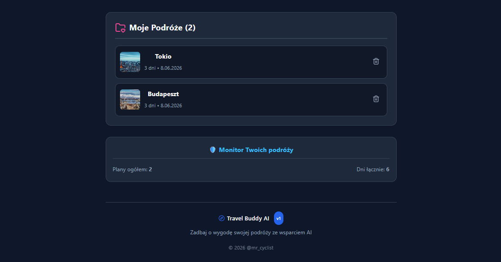
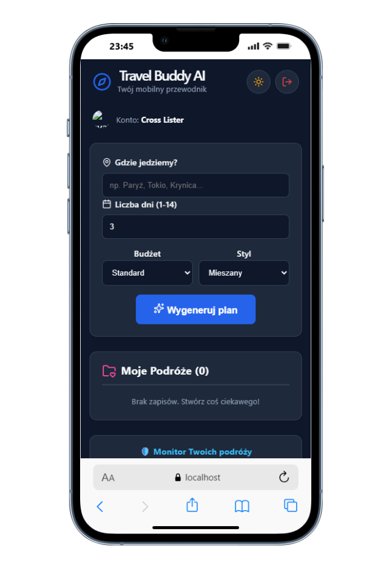
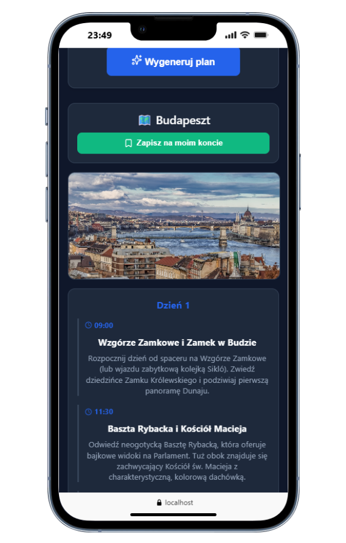

# Travel Buddy AI

This application will help you manage your travels. Fullstack application connected backend and frontend connected with AI.

# Project Name

- This application will help you manage your travel plans. You can generate new itineraries, edit activities, and delete every single plan. Authentication with Google and subsequent logging in at any time will allow you to conveniently access your saved data. Addition of Gemini AI Model that proposes new ideas, activities consistent with your destination, budget and style. Planning a trip has never been more useful and exciting.

# Installation

Backend (FastAPI)

1. Navigate to the project directory and set up a virtual environment:
   python -m venv venv
   source venv/bin/activate

Install dependencies:
pip install -r requirements.txt

Run the development server:
uvicorn api.main:app --reload

## Table of Contents

- [General Info](#general-information)
- [Technologies Used](#technologies-used)
- [Features](#features)
- [Screenshots](#screenshots)
- [Acknowledgements](#acknowledgements)
- [Contact](#contact)

## General Information

- This is a full-stack solution combining React and a high-performance Python FastAPI backend. An excellent project combining modern web development with advanced data validation (Pydantic) and serverless deployment readiness (Vercel). A local JSON database and FastAPI backend allow all functionalities to work smoothly, ensuring data is saved, restored, and accessible at any time for authenticated users. It features the Google Gemini AI Model acting as a professional tour guide, combined with the Unsplash API to dynamically fetch beautiful destination photos. The backend is also fully covered with unit tests using pytest.

## Technologies Used

- HTML5 Markup
- CSS
- RWD - Responsive Web Design
- JavaScript
- React
- NodeJS
- Python, FastAPI, Uvicorn, Pydantic
- pytest, FastAPI TestClient, unittest.mock
- JSON Database / Local Storage
- Firebase Authentication (Google LogIn)
- Google Gemini AI Model (Flash Latest)
- Unsplash API

## Features

- **Guest Mode:** Anyone can browse the application and generate travel plans without immediate authentication.
- **AI-Powered Generation:** Instant, detailed day-by-day travel plan generation based on destination, days, budget, and travel style.
- **Dynamic Photos:** Automatic destination image fetching directly from Unsplash API.
- **Full In-App Editor:** Authenticated users can modify times, titles, and descriptions of activities, or add new points to the itinerary.
- **Google Authentication:** Secure and quick login using Google Accounts via Firebase Auth.
- **Dark Mode:** Fluid UI color scheme swapping (Light / Dark) for night-time planning comfort.
- **Dashboard Monitor:** Visual statistics and overview of total saved trips and overall days planned.
- **Robust Unit Testing:** Fully tested backend logic running offline via `pytest` and mock services.

## Screenshots

## Acknowledgements

- Inspired by a passion for cycling, active travel, and modern AI capabilities.

## Contact

Created by [@mr_cyclist] - contact me!
